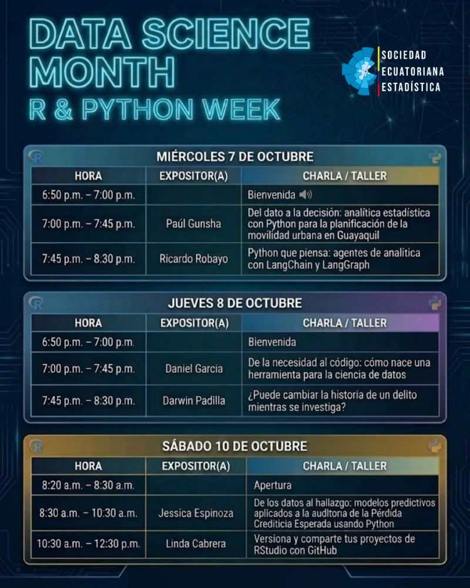

# Versiona y comparte tus proyectos de RStudio con GitHub

Material del taller impartido en la **R & Python Week** de la [Sociedad Ecuatoriana de Estadística](https://see-ec.org/wordpress/).

¿Cuántas veces has guardado un archivo como `analisis_final_v3_DEFINITIVO.R`? En este taller aprenderás a trabajar con control de versiones usando Git y GitHub directamente desde RStudio, para que tus proyectos tengan historial, estén respaldados y puedas compartirlos con quien quieras.

## Datos del taller

| | |
|---|---|
| **Evento** | R & Python Week, Sociedad Ecuatoriana de Estadística |
| **Fecha** | Sábado 10 de octubre de 2026 |
| **Hora** | 10:30 (Ecuador, UTC−5) · 15:30 UTC |
| **Duración** | 2 horas |
| **Modalidad** | En línea |
| **Imparte** | Linda Cabrera Orellana |

## ¿Para quién es?

Para personas que ya trabajan con R y RStudio. El objetivo no es aprender a usar RStudio, sino versionar y compartir proyectos, así que lo aprovecharás mucho más si ya escribes tus propios scripts o informes.

Antes del taller sigue la **[guía de instalación](guia-instalacion.md)** paso a paso.

## Contenido

1. **rOpenSci**, la comunidad que impulsa software científico abierto y reproducible en R.
2. **Qué son Git y GitHub** y cómo es el flujo de trabajo con control de versiones.
3. **Configuración** de Git y GitHub en RStudio con `usethis` y `gitcreds`.
4. **GitHub primero**, crear un repositorio y clonarlo como proyecto de RStudio.
5. **Proyecto existente**, versionar y publicar un proyecto que ya tienes.
6. **Compartir bien**, con README y `.gitignore`.
7. **Errores frecuentes** y cómo salir de ellos.

## Material

| Recurso | Descripción |
|---|---|
| [Guía de instalación](guia-instalacion.md) | Qué instalar antes del taller y cómo comprobarlo |
| [Código del Taller](R/codigo-taller.R) | Código que utilizaremos durante el Taller |
| [Slides](slides_github+rstudio.pdf) |  |

## Recursos para seguir aprendiendo

- [Happy Git and GitHub for the useR](https://happygitwithr.com/), la referencia para usar Git con R.
- [Documentación de usethis](https://usethis.r-lib.org/).
- [Writing your first documentation PR](https://github.com/tidyverse/tidy-dev-day/blob/main/worksheet/index.pdf)
- [rOpenSci](https://ropensci.org/) y su guía de desarrollo de paquetes.
- [Simulador de flujo de trabajo de control de versiones](https://lindateachtech.netlify.app/blogs/simulador-flujo-control-de-versiones/)

## Sobre este taller

Este taller forma parte de mi participación en el programa [rOpenSci Champions](https://ropensci.org/champions/) 2026. Me acompañará y guiará parte del Taller, mi mentor del programa, Luis D. Verde Arregoitia.

**Linda Cabrera Orellana** · [Web](https://lindateachtech.netlify.app/) · [GitHub](https://github.com/lindateachtech)

**Luis D. Verde Arregoitia** · [Web](https://luisdva.github.io/) · [GitHub](https://github.com/luisDVA)

## Links al evento

## Licencia

El material de este taller se comparte bajo licencia [CC BY 4.0](https://creativecommons.org/licenses/by/4.0/deed.es). Puedes usarlo y adaptarlo citando la fuente.
